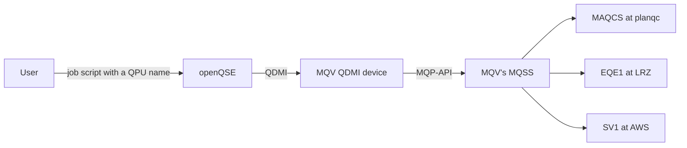

# Demo: a user picks MAQCS, EQE1 or AWS

For the demo let's suppose we have an openQSE user on an HPC cluster. The site offers three MQV resources as QPU names. The user runs one program on MAQCS, one on EQE1 and one on AWS, through MQV's MQSS.


## The path in one picture



> openQSE doesn't know MQSS. It only loads our QDMI device through MQT Core, like the IQM and AWS devices. Our device turns each job into an MQP-API call.

## What the site offers

The site offers MQV's machines to its users as **QPU names**, like it offers partitions.

A user picks a QPU name in the job script, for example EQE1:
```bash
#SBATCH --qpu=sc26-mqv-eqe1
```

In the program, the user creates a Qiskit backend for the matching **service**. Its name is always `shim-` plus the QPU name:
```python
eqe1 = QFwBackend(provider="shim", service_id="shim-sc26-mqv-eqe1")
```

| QPU name | Service | Runs on |
|---|---|---|
| `sc26-mqv-maqcs` | `shim-sc26-mqv-maqcs` | MAQCS, a simulator from planqc |
| `sc26-mqv-eqe1` | `shim-sc26-mqv-eqe1` | EQE1, an IQM quantum computer at LRZ |
| `sc26-mqv-aws` | `shim-sc26-mqv-aws` | SV1, a simulator at Amazon Web Services |


## Part 1: The demo

### 1.1 Where we are

> This is openQSE's reference testbed, QFw-SLURM-Cluster, on an MQV VM. I'm the user `user-a`. The site offers three MQV resources: MAQCS, EQE1 and AWS.

### 1.2 Log in to the cluster

Opens a shell as `user-a`, in the folder with my files (on a real cluster: `ssh <login node>`):
```bash
docker exec -it -u user-a -w /workspace/home/user-a/demo slurmctld bash -l
```

### 1.3 User's files

Lists my files:
```bash
ls
```

Shows the program for MAQCS:
```bash
cat ghz_maqcs.py
```

> Plain Qiskit: a GHZ circuit on three qubits. The only openQSE line is the backend for the service `shim-sc26-mqv-maqcs`.

Shows the job script for MAQCS:
```bash
cat ghz_maqcs.sbatch
```

> The QPU is picked with `--qpu`.

### 1.4 Submit the three jobs

```bash
sbatch ghz_maqcs.sbatch
sbatch ghz_eqe1.sbatch
sbatch ghz_aws.sbatch
```

### 1.5 Watch them run

```bash
squeue -u user-a
```

```bash
sacct -X -S now-15minutes -o JobID,JobName%16,State,Elapsed
```
Repeat until all three are `COMPLETED`. EQE1 takes one to two minutes.

### 1.6 Results

```bash
ls slurm-*.out
```

Replace `<N>` with the job number:
```bash
cat slurm-<N>.out
```

The file ends with the result, for example:
```
EQE1 counts: {'000': 50, '001': 5, '101': 2, '110': 1, '111': 42}
```

> A GHZ state gives mostly 000 and 111.

### 1.7 Log out

```bash
exit
```


## After the demo

Nothing to clean up. Close the SSH session.

---

## Appendix: Preparation for the presenter (few minutes before the demo)

### A.1 MAQCS, EQE1 and AWS are online

In the portal, under *Available System Resources*, check **MAQCS**, **EQE1** and **AWS**: all `Online`.

`Online` doesn't guarantee that jobs run. Two hours before the demo, send one test job to each resource, for example a Bell circuit.

MAQCS and EQE1, with the MQSS Qiskit adapter:
```python
import os

from mqss.qiskit_adapter import MQSSQiskitAdapter
from qiskit import QuantumCircuit

adapter = MQSSQiskitAdapter(token=os.environ["MQSS_TOKEN"], hpcqc=False, base_url="https://test.quantumpathway.eu:4000")
circuit = QuantumCircuit(2)
circuit.h(0)
circuit.cx(0, 1)
circuit.measure_all()
for resource in ("MAQCS", "EQE1"):
    job = adapter.get_backend(resource).run(circuit, shots=100, no_modify=True, queued=True)
    print(resource, job.client.wait_for_job_result(job.job_id(), job.job_request).counts)
```

AWS, with the MQSS Python client: SV1 cancels what the adapter sends from a Qiskit circuit (`include`, `cx`), so the program is sent as OpenQASM 3 text without `include` and with `cnot`:
```python
import os

from mqss_client.job import CircuitJobRequest
from mqss_client.mqss_client import MQSSClient

program = """OPENQASM 3.0;
qubit[2] q;
bit[2] c;
h q[0];
cnot q[0], q[1];
c[0] = measure q[0];
c[1] = measure q[1];
"""
client = MQSSClient(token=os.environ["MQSS_TOKEN"], base_url="https://test.quantumpathway.eu:4000")
request = CircuitJobRequest(circuits=str([program]), circuit_format="qasm3", resource_name="AWS",
                            shots=100, no_modify=True, queued=False)
request.uuid = client.submit_job(request)
print("AWS", client.wait_for_job_result(request.uuid, request).counts)
```

All three must complete. If one is cancelled, contact the MQSS team with the job number, and show that resource with the results of the dry run (A.7).

### A.2 The containers are up

Lists every container of the testbed with its status. All must be running:
```bash
docker ps --format '{{.Names}}\t{{.Status}}' | sort
```
Expect 21 lines, all `Up`.

### A.3 The three QPUs point to MQV

Prints, for each QPU, the device ID and the MQP-API URL the site configured:
```bash
for q in sc26-mqv-maqcs sc26-mqv-eqe1 sc26-mqv-aws; do
  docker exec shim-head grep -A3 "^  $q:" /etc/openqse/qfw/device/device-access.yaml | grep -E "^  sc26|provider-device-id|url"
done
```
Expect `mqv.maqcs`, `mqv.eqe1` and `mqv.default`, all with `url: https://test.quantumpathway.eu:4000/v1/`. `mqv.default` has no fixed resource: its service gets the resource `AWS` when it starts (A.5).

### A.4 Directory service and gateway are up

Asks for the status of QFw's directory service (where QPM services register) and the qfw-slurm gateway (which reserves them for jobs):
```bash
docker exec slurmctld bash -lc 'qfw-site-services --target directory status; qfw-site-services --target gateway status' | grep -E "Directory|Gateway"
```
Expect `Directory: UP` and `Gateway: UP`.

### A.5 Start the three services with the presenter's token

Only needed if the services aren't running: after a restart of the testbed or of `shim-head`, after a token change, or when the dry run (A.7) fails with `403`. Services that run since the last start keep working; skip this step then.

Keeps the MQP-API token in a shell variable, without showing it on screen or saving it in the history (paste it, press Enter):
```bash
read -rs MQV_TEST_TOKEN && export MQV_TEST_TOKEN
```

Stops each service if it runs, and starts it again with the token (as `QFW_API_KEY`). The AWS service also gets its resource (`MQV_QDMI_RESOURCE=AWS`) and the form of OpenQASM 3 that SV1 accepts (`SC26_QASM3_DIALECT=braket`). The last line removes the token from the shell:
```bash
for s in shim-sc26-mqv-maqcs shim-sc26-mqv-eqe1 shim-sc26-mqv-aws; do
  echo "== $s"
  extra=""
  [ "$s" = shim-sc26-mqv-aws ] && extra="-e MQV_QDMI_RESOURCE=AWS -e SC26_QASM3_DIALECT=braket"
  docker exec shim-head bash -lc "source /opt/openqse/qfw/bin/qfw-activate --venv /opt/openqse/qfw-venv && qfw-qpm-svc stop --run-dir /var/lib/qfw-site-services/qpm/$s" > /dev/null 2>&1 || true
  QFW_API_KEY="$MQV_TEST_TOKEN" docker exec -w /tmp \
    -e QFW_API_KEY \
    -e SC26_PROGRAM_FORMAT=QASM3 \
    $extra \
    -e PYTHONPATH=/workspace/qfw-container-base/sc26-wheels/site-0.1.2-b148cc2 \
    -e DEFW_EXTERNAL_SERVICES_PATH=/workspace/qfw-container-base/sc26-tools/qfw/services:/opt/openqse/qfw/lib/qfw/services \
    -e QFW_SHARED_ROOT=/workspace/qfw-container-base -e QFW_SITE_CONFIG=/etc/openqse/qfw/site.yaml \
    shim-head bash -lc "source /opt/openqse/qfw/bin/qfw-activate --venv /opt/openqse/qfw-venv && qfw-qpm-svc start --scope site --run-dir /var/lib/qfw-site-services/qpm/$s --site-config /etc/openqse/qfw/site.yaml --service-id $s --timeout 300" 2>&1 | grep -E '^  "state"|rror'
done
unset MQV_TEST_TOKEN
```
Expect `"state": "ready"` for all three. The token now lives only in the three running services. All three load the MQV QDMI device from `sc26-wheels/site-0.1.2-b148cc2`.

### A.6 Create the user's files

The files the user "wrote", in `user-a`'s home, folder `demo/`: three Python programs and three job scripts.

Writes the program for MAQCS:
```bash
docker exec -i -u user-a slurmctld bash -c 'mkdir -p /workspace/home/user-a/demo && cat > /workspace/home/user-a/demo/ghz_maqcs.py' <<'EOF'
# GHZ on the QPU sc26-mqv-maqcs (MAQCS through MQV's MQSS).
from qiskit import QuantumCircuit
from qfw_qiskit import QFwBackend

qc = QuantumCircuit(3)
qc.h(0)
qc.cx(0, 1)
qc.cx(1, 2)
qc.measure_all()

# The backend of the QPU this job reserved: its service is "shim-" + the QPU name.
maqcs = QFwBackend(provider="shim", service_id="shim-sc26-mqv-maqcs")

job = maqcs.run(qc, shots=100)
print("MAQCS counts:", job.result().get_counts())
EOF
```

Writes the program for EQE1:
```bash
docker exec -i -u user-a slurmctld bash -c 'cat > /workspace/home/user-a/demo/ghz_eqe1.py' <<'EOF'
# GHZ on the QPU sc26-mqv-eqe1 (EQE1, IQM at LRZ, through MQV's MQSS).
from qiskit import QuantumCircuit
from qfw_qiskit import QFwBackend

qc = QuantumCircuit(3)
qc.h(0)
qc.cx(0, 1)
qc.cx(1, 2)
qc.measure_all()

# The backend of the QPU this job reserved: its service is "shim-" + the QPU name.
eqe1 = QFwBackend(provider="shim", service_id="shim-sc26-mqv-eqe1")

job = eqe1.run(qc, shots=100)
print("EQE1 counts:", job.result().get_counts())
EOF
```

Writes the program for AWS:
```bash
docker exec -i -u user-a slurmctld bash -c 'cat > /workspace/home/user-a/demo/ghz_aws.py' <<'EOF'
# GHZ on the QPU sc26-mqv-aws (AWS SV1 simulator, through MQV's MQSS).
from qiskit import QuantumCircuit
from qfw_qiskit import QFwBackend

qc = QuantumCircuit(3)
qc.h(0)
qc.cx(0, 1)
qc.cx(1, 2)
qc.measure_all()

# The backend of the QPU this job reserved: its service is "shim-" + the QPU name.
aws = QFwBackend(provider="shim", service_id="shim-sc26-mqv-aws")

job = aws.run(qc, shots=100)
print("AWS counts:", job.result().get_counts())
EOF
```

Writes the three job scripts. They are the same text; only the job name, the `--qpu` line and the program differ:
```bash
make_sbatch() {  # file, job name, QPU, program
  docker exec -i -u user-a slurmctld bash -c "cat > /workspace/home/user-a/demo/$1" <<EOF
#!/bin/bash
#SBATCH --job-name=$2
#SBATCH --account=qfw-test
#SBATCH --partition=normal
#SBATCH --nodes=1
#SBATCH --ntasks=1
#SBATCH --time=00:10:00
# The quantum resource(s) this job needs (QPU names the site offers):
#SBATCH --qpu=$3
# What the job will send, so the QPU(s) can be reserved for it:
#SBATCH --workload-kind=quantum
#SBATCH --circ-count=1
#SBATCH --max-qubits=3
#SBATCH --max-depth=100
#SBATCH --max-shots=100

# Start QFw for this job, run the program, stop QFw again.
source /opt/openqse/qfw/bin/qfw-activate --venv /opt/openqse/qfw-venv
export QFW_SHARED_ROOT=/workspace/qfw-container-base
export QFW_RUN_BASE_DIR=\$HOME/qfw-runs
export DEFW_LOG_LEVEL=error DEFW_PY_LOGLEVEL=critical
mkdir -p "\$QFW_RUN_BASE_DIR"

qfw-setup
trap qfw-teardown EXIT
qfw-srun /workspace/home/user-a/demo/$4
EOF
}
make_sbatch ghz_maqcs.sbatch ghz-maqcs sc26-mqv-maqcs ghz_maqcs.py
make_sbatch ghz_eqe1.sbatch ghz-eqe1 sc26-mqv-eqe1 ghz_eqe1.py
make_sbatch ghz_aws.sbatch ghz-aws sc26-mqv-aws ghz_aws.py
```

Lists the folder, to check that all six files are there:
```bash
docker exec -u user-a slurmctld ls -l /workspace/home/user-a/demo
```

### A.7 Dry run

Run Part 1, steps 1.2 and 1.4 to 1.7, once. All three jobs must show their counts. A job submitted right after a service was (re)started can hang in `PENDING`; the dry run catches that before the demo.

If a job ends with `Checking job status: A fatal error` in its `slurm-<N>.out`, submit it again.

Then delete the dry run's output files, so the folder looks clean for the demo:
```bash
docker exec -u user-a slurmctld bash -c 'rm -f /workspace/home/user-a/demo/slurm-*.out'
```
